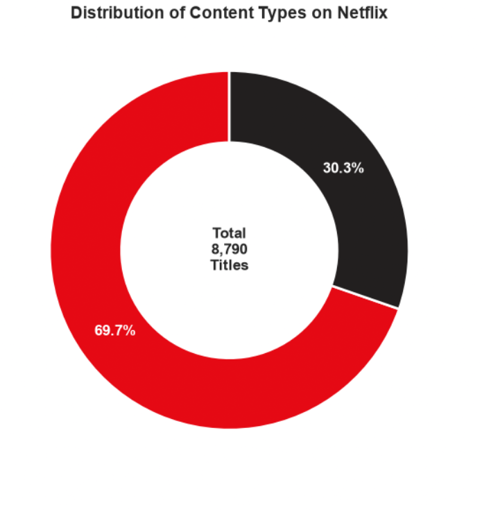
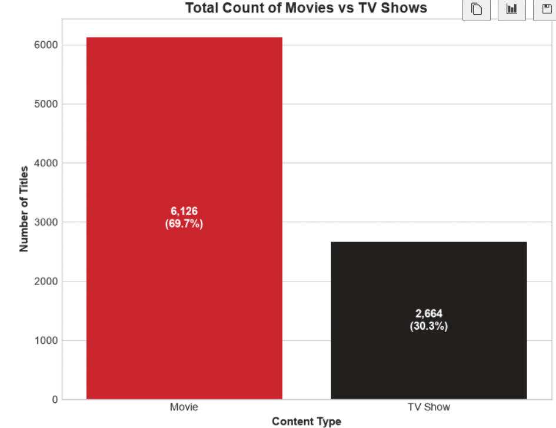
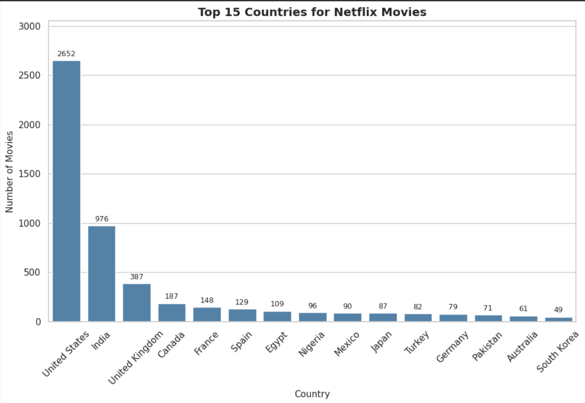
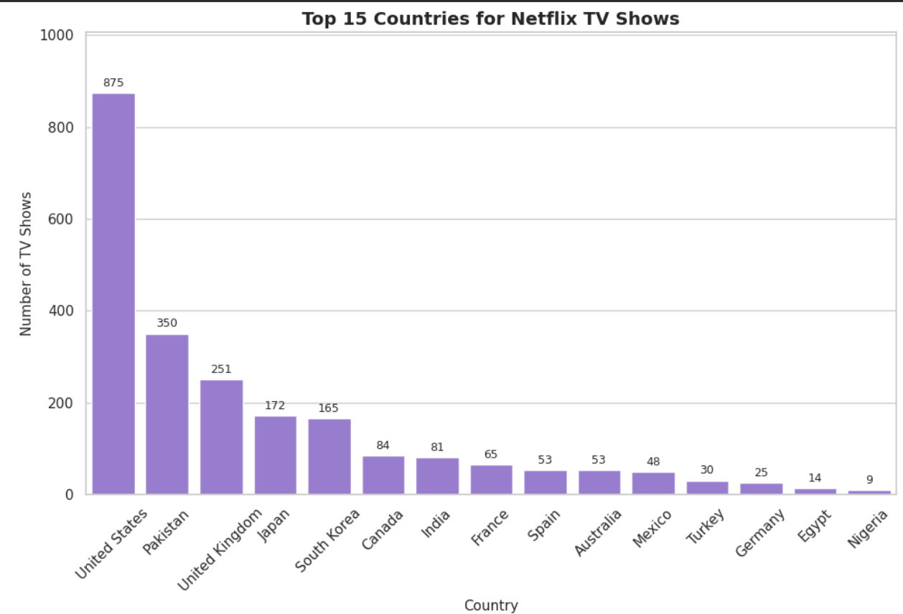

# Netflix-Data-Analysis
Analyzing and visualizing the Netflix library using Python through six tasks presented by Auspify Technologies

## Tasks Progress
- [x] Task 1 : Netflix Data Cleaning & Preparation
- [x] Task 2 : Content Type Analysis
- [x] Task 3 : Country-Wise Content Analysis
- [ ] Task 4 : Content Rating & Genre Analysis
- [ ] Task 5 : Trend Analysis by Release Year
- [ ] Task 6 : Netflix Business Insights Report

# Task 1
Cleaning and preparing the raw Netflix dataset (8,790 titles) for accurate business analytics and reporting.

### Task Workflow
* **Step 1: Data Import** — Loaded `Dataset.csv` using Pandas and inspected missing values and data types
* **Step 2: Missing Values** — Replace missing values ​​in `director` with `Unknown` and `country` with `Mode`
* **Step 3: Deduplication** — Removed duplicate rows and remove excess whitespace from the beginning and end of string fields
* **Step 4: Standardization** — Converted `date_added` to `datetime` (`YYYY-MM-DD`) 
* **Step 5: Dataset Export** — Exported the clean dataset to `Cleaned_Dataset.csv`

---

### Summary of Cleaning Actions

| Column / Feature | Action Taken |
| :--- | :--- |
| **Missing Values** | Filled nulls in `director` and `country` with `'Unknown'` and `Mode` |
| **Text Casing & Spaces** | Remove whitespace and standardized casing across text columns |
| **`date_added`** | Parsed string dates into standard `YYYY-MM-DD` format |

---

### Task Artifacts
* `Dataset.csv` — Raw dataset
* `task1.ipynb` — Data cleaning script
* `Cleaned_Dataset.csv` — Final cleaned dataset

# Task 2
Analyzing the baseline distribution and proportions of Movies and TV Shows available on Netflix

### Key points :
* Total Titles Analyzed : 8790
* Movies Count : 6126 (69.7%)
* TV Shows Count : 2664 (30.3%)

### Visualization :

### Business Insights And Recommendations :
* **Most Preferred Content :** Movies make up approximately **70%** of the total library driven by rapid production and release cycles
* **Engagement vs. Volume :** While movies account for the majority of the content TV series are the primary driver of long term user retention and subscription growth
* **Strategic Move :** Netflix should balance its content portfolio by increasing investment in TV series to reduce churn rates

# Task 3
Analyze Netflix content distribution across different countries to identify primary global production hubs and evaluate content type preferences (Movies vs. TV Shows) in top-producing regions

### Workflow & Data Processing :
1. **Data Preparation :** Handled missing values and split , exploded multi-country records (cells with comma-separated countries) into individual rows to ensure accurate per-country counting
2. **Aggregation & Ranking :** Grouped the data by country to calculate total content output, isolating the **Top 15 countries** with the highest production volume*
3. **Content Segmentation :** Filtered content to separately analyze Movies and TV Shows across these top markets
4. **Proportional Analysis :** Computed specific percentages of Movies vs. TV Shows within leading regions to uncover local content consumption trends

### Key Visualizations :
* **Top 15 Countries for Netflix Movies:** A dedicated bar chart showcasing major movie-producing nations with exact data labels
* **Top 15 Countries for Netflix TV Shows:** A dedicated bar chart analyzing serial content distribution across leading markets

### Business Insights And Recommendations :
* **Absolute Dominance of the United States :** The United States leads the platform by a massive margin in both categories, recording approximately 2,652 movies and 875 TV shows, establishing itself as the primary content hub globally

* **India's Movie-Centric Focus :** India secures the second position globally for movies with 976 films, but drops significantly in TV shows with only 81 series, highlighting a heavy market preference toward feature-length cinema

* **Rise of Asian Markets in Series :** Asian countries like Japan and South Korea show a strong presence in television series (172 for Japan and 165 for South Korea) compared to their movie output, reflecting the success of localized regional investments like K-dramas

* **Regional Production Discrepancy :** Emerging markets such as Egypt and Nigeria feature moderately in movie production (109 movies for Egypt and 96 for Nigeria) while having a very low representation in TV shows (14 and 9 respectively), indicating a local inclination toward cinematic releases over serialized content

## Actionable Recommendations :

### for Asian Markets :

Given the notable success of TV series in Japan and South Korea, Netflix should increase investment in local drama productions and K-Dramas to drive growth in these markets

### for Emerging Markets (Egypt and Nigeria) :

Since production in Egypt and Nigeria focuses heavily on feature films rather than TV series, it is recommended to prioritize acquiring digital rights to popular films in the region to attract more local subscribers

### for Production Strategy :

Given the United States' overwhelming dominance, content investments should be diversified regionally to reduce reliance on a single market and create a more comprehensive library for the global audience
